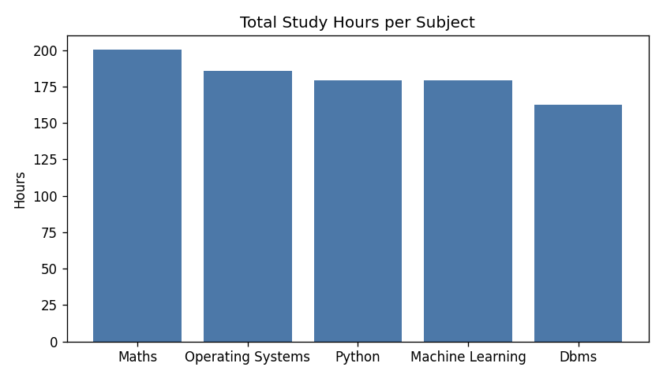
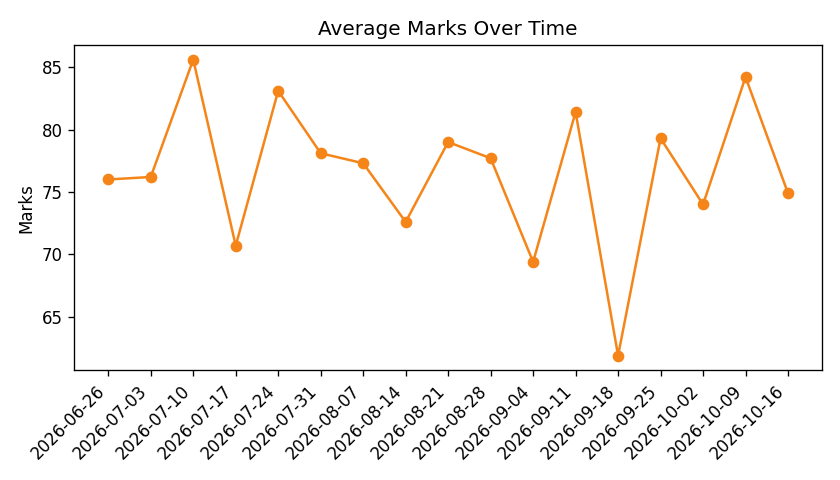

# StudyPulse - Study Habit Tracker with Score Predictor

A small command-line tool that logs your daily study and sleep hours in a **SQL database**, finds patterns using **SQL queries**, and uses a **machine learning model** to predict your next test score.

Built with: **Python, SQLite, pandas, scikit-learn, matplotlib**

## Features
- Log daily study hours and sleep hours per subject
- Record test marks
- SQL insights: total hours per subject, weakest subject, best study weekday, and the effect of sleep on marks (uses `GROUP BY`, `JOIN`, `CASE`, `strftime`)
- AI prediction: Linear Regression predicts marks from average study hours and sleep hours
- Auto-generated charts (hours per subject, marks over time)

## Project Structure
```
studypulse/
|-- main.py          # command-line menu
|-- db.py            # database functions (SQLite)
|-- schema.sql       # table definitions
|-- analysis.py      # SQL insights + matplotlib charts
|-- model.py         # linear regression model
|-- seed_data.py     # generates sample data to try the project
|-- requirements.txt
```

## How to Run
```bash
pip install -r requirements.txt
python seed_data.py     # optional: adds sample data
python main.py
```

## How the AI Part Works
1. For every test, SQL collects the logs of the **7 days before** it and averages study hours and sleep hours.
2. A Linear Regression model learns: `marks = a * study_hours + b * sleep_hours + c`.
3. You enter your planned habits and it predicts the marks.

The model needs at least 5 tests with logs. R2 score is shown so you can see how well it fits.

## Note on Data
`seed_data.py` creates **synthetic** sample data for demo purposes. For real insights, log your own data for a few weeks.

## Screenshots
Add your screenshots here (run option 5 in the menu to create charts in the `charts/` folder):




## Future Improvements
- Streamlit web dashboard
- Try Random Forest and compare with Linear Regression
- Add exam countdown and daily study goals
